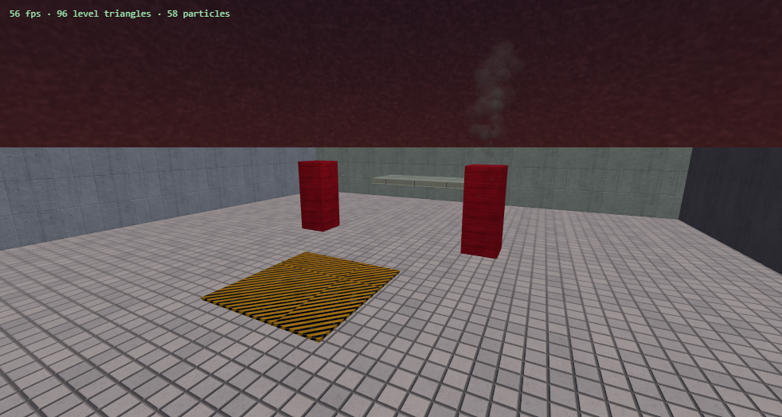

# Arterial

A 3D game engine for the browser, written in TypeScript on [three.js](https://threejs.org) — **with no WebAssembly
anywhere in it.** It is the engine underneath SANGUINE, a fast first-person shooter built to run on low-end
machines like a school Chromebook, taken out on its own: just the engine, none of the game.



## No WebAssembly — and why that matters

Many browser engines that do real physics or heavy geometry lean on WebAssembly: a physics library compiled from
C++ or Rust, a mesh optimiser, a navigation library. Arterial does all of its work in plain JavaScript (TypeScript
compiled down) and on the GPU, and that buys it a lot:

- **It runs where WebAssembly is switched off.** Some browsers turn WebAssembly off in their hardened modes
  (Safari's Lockdown Mode, Microsoft Edge's enhanced security mode), and locked-down managed machines can restrict
  it. An engine that needs a `.wasm` file does not start there at all; Arterial only needs JavaScript and WebGL 2.
- **No binary to download, compile or wait for.** There is no multi-megabyte `.wasm` to fetch and compile before
  the first frame, and no async instantiation step to orchestrate at start-up. The engine is part of the same
  JavaScript bundle as the game and is ready the moment the page is.
- **One language, one debugger.** Every line — collision, baking, particles — is TypeScript you can read, set a
  breakpoint in and profile with the browser's own tools. No opaque compiled module, no glue code, no copying
  data back and forth across a JS/WASM boundary every frame.
- **Nothing to build but the bundle.** No Emscripten or Rust toolchain, no native build step: `npm install` and
  Vite are the whole toolchain.
- **Small and transparent.** The engine is a few dozen readable source files, not a vendored binary, so it can be
  changed to suit the game instead of the game bending around the library.
- **Fast where it counts, by doing less.** Instead of a general physics engine, collision is a bounding-volume
  hierarchy over the baked level (three-mesh-bvh) plus simple moving bodies; particles are moved analytically on
  the GPU, so the CPU writes each one once at birth and never again; the static level is merged into a handful of
  draw calls. On a low-end machine the CPU is the bottleneck, and these choices keep it free.

## What is in it

**engine/** — the core.
- `World`: entities, an event bus, a level format (`LevelFile`, plain JSON), loading and saving.
- Baked, streamed static level (`StaticChunks`): the level is cut into cells, each baked into merged meshes and
  collision with hidden faces culled; cells are built as the camera nears them and let go as it leaves.
- Point-light pool: as many placed lights as you like, the nearest few lent real lights each frame.
- Static batching: small props drawn as one mesh per material, with pieces that can still be knocked out.
- Particle engine: GPU-analytic batches (soft, smoke, glow, streak, tracer, fireball) plus CPU chunk pools for
  debris; effects are named data, fired by name, streamed by emitters or triggered by events.
- Cutscenes (camera paths, captions, fades, scripted input) and quests (objectives driven by events).
- What surfaces are made of (stone, steel, grating, lava), for sounds and ricochets.

**physics/** — the collision system: a BVH over the baked level, moving bodies, ray casts, capsule tests.

**core/** — a fixed-step loop (120 Hz simulation, interpolated rendering), input with pointer lock, persisted
settings.

**render/** — procedural surface textures and materials (no image files needed), the level material, a procedural
sky, an AMD FidelityFX Super Resolution 1 port (EASU + RCAS), an upscaler, frame generation (reprojection),
dynamic resolution, a GPU timer, mesh decimation for level-of-detail copies.

**entities/** — the engine's own entity types: `brush` (level geometry), `spawn`, `trigger` (event volumes),
`light`. A game registers its own beside them with `registerEntity`.

**prefabs/geometry** — helpers for building placeable pieces out of parts laid out in fractions of their size.

## Quick start

```bash
npm install
npm run dev      # the example scene: http://localhost:5173
npm run build    # type-check and build
```

The example (`example/main.ts`) is the smallest useful program: a level loaded from JSON, baked and streamed, a
sky, a smoke stream and bursts of sparks, a camera circling it, and the fixed-step loop driving it all.

```ts
import { World, Loop, registerCoreEntities, applySky, prepareLevelMaterial } from './src'

registerCoreEntities()
const world = new World()
prepareLevelMaterial(renderer)
applySky(world.scene)
world.load(level) // a LevelFile: { name, version: 1, entities: [...] }

world.particles.register('sparks', { layers: [{ style: 'streak', count: 24, speed: 9, spread: 0.9, life: 0.6, size: 0.05, color: 0xffc070, gravity: 14 }] })

const loop = new Loop(
  (dt) => world.update(dt),
  () => {
    world.updateLod(camera.position)
    world.particles.update(loop.stats.frameMs / 1000, camera)
    renderer.render(world.scene, camera)
  },
)
loop.start()
```

## Requirements

A browser with WebGL 2. Dependencies: `three` and `three-mesh-bvh` (both MIT).

## Credits

- [three.js](https://threejs.org) — MIT.
- [three-mesh-bvh](https://github.com/gkjohnson/three-mesh-bvh) — Garrett Johnson, MIT.
- AMD FidelityFX Super Resolution 1 — Advanced Micro Devices, MIT (ported in `src/render/fsr1.ts`, with AMD's
  notice kept).
